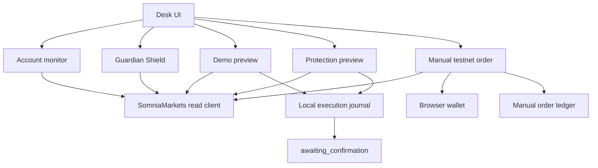

# Liquidation Guardian

Protocol-based liquidation-risk monitor for dreamDEX Perps on Somnia Tokyo testnet. The SDK calls that network Hideki. The deployment this app checks is Hideki v2, chain id 50383.

This is **not** an automated liquidation bot. It reads public protocol state, classifies account health, and can propose a protective order without signing it.

A separate **Manual Testnet Order** panel can ask a browser wallet to sign one minimum BTC-PERP post-only order. That path is explicit and one order at a time. Guardian monitoring, Shield, and the unsigned protection preview still cannot send. Nothing in this repository was submitted to the chain while preparing this update.

## Problem

A cross-margin perpetual can be liquidated when account equity falls through the protocol maintenance requirement. Watching that by hand is slow, and an opposite-side order is not automatically reduce-only. Liquidation Guardian shows the protocol's own health numbers and stops at an unsigned proposal when a configured danger or critical band is crossed.

## How it works

1. A public address is entered for monitoring. That box does not connect a wallet.
2. A separate review can ask a browser wallet for its address and chain. It cannot request a key or send a transaction.
3. The server opens `@somnia-chain/markets-sdk` against Hideki v2 and reads margin, health, positions, marks, and liquidation prices.
4. Health is equity divided by the protocol maintenance requirement, only when both values are comparable and the snapshot is priceable and consistent.
5. **Demo preview** may describe a reduction on a healthy position. It is labeled demonstration only.
6. **Protection preview** proposes a reduction only at danger or critical (warning only if that box is checked). It refuses a healthy account.
7. Both preview paths stop at `awaiting_confirmation`. They do not sign.
8. **Manual Testnet Order** is the only path that can ask a wallet to sign. It is not wired to the protection preview.

## Manual Testnet Order

The panel sits under the unsigned wallet review. It does not replace monitoring or Shield.

What it will sign, and only after a checkbox:

- Market: BTC-PERP, read from `listPerpMarkets` where `baseSymbol` is `BTC`
- Quantity: the pool minimum, rounded up to the lot
- Type: `ORDER_TYPE.POST_ONLY` (3) only. No IOC, no market, no typed price
- Price: one tick off the mark, buy below and sell above, and strictly behind the best opposing on-chain price
- Signer: `createTrader({ walletClient })` from the browser wallet. No private key is requested or stored

Before the wallet is prompted, the app re-reads Hideki v2 and refuses the quote unless all of these hold:

| Check | Required value |
|---|---|
| Chain id | 50383 |
| `net_version` on the app RPC and on the wallet RPC | `50000259` |
| RPC host used for protocol reads | `api.hideki2.infra.testnet.somnia.network` |
| BTC pool | Factory-owned, with code, and its margin bank matches the SDK Hideki deployment |
| Book | Known. A buy at or above the best ask, or a sell at or below the best bid, is refused |
| Account size | `getMaxPerpOrderSize` says the minimum is placeable |
| Quote age | 20 seconds |

The panel shows notional, maker fee, the taker-fee note, initial and maintenance margin, collateral, unlocked collateral, equity, the current position, and the exposure if a later fill happens.

The same economic intent (wallet, pool, side, price, quantity) is stored in `localStorage` under `lg.manual-order.v1` before the signature, along with the transaction hash as soon as one exists. A refresh reconciles that record on the Hideki v2 RPC: receipt first, then `getOpenOrdersOnchain`. A pending or unknown hash blocks every new signature. Acknowledging an unknown hash does not unlock it. A reverted receipt releases only that intent. A successful receipt, or a matching resting order, stays locked.

This button does not deposit, approve, or claim a voucher. Gas is STT on the signing address. Paper USDso must already be in the MarginBank.

### Wallet requirements

Use a browser wallet that speaks EIP-1193 (`window.ethereum`). The app may call only:

- `wallet_switchEthereumChain` / `wallet_addEthereumChain` for chain `0xc4cf`
- `eth_requestAccounts`, `eth_accounts`, `eth_chainId`
- `net_version` and `eth_getCode` on the wallet's own RPC, immediately before signing
- the SDK send that follows `createTrader({ walletClient })`

Chain id 50383 is shared with an older Hideki network (`net_version` `50000258`). The wallet does not expose its configured RPC URL, so chain id alone is refused. If `net_version` is missing, wrong, or the BTC pool has no code on the wallet's RPC, nothing is signed. Point the wallet's RPC for this chain at `https://api.hideki2.infra.testnet.somnia.network` and try again.

If the chain is already saved with the older RPC, `wallet_addEthereumChain` will not replace it. Edit the network in the wallet.

## dreamDEX SDK

Package: `@somnia-chain/markets-sdk` **0.32.1**, chain helper `hidekiTestnet`.

Read methods used by monitoring and by the manual quote:

| Method | Use |
|---|---|
| `listPerpMarkets` | Registered perp pools |
| `getPerpSystemConfig` | Margin bank, live collateral, leverage limit |
| `getPerpRiskParams` | Initial, maintenance, and close-out margin, plus fees |
| `getPerpHealthSnapshot` | Pool mark and whether it is priceable |
| `getMarginAccount` | Equity, requirements, block |
| `getAccountHealth` | Second health read, checked against the margin account |
| `listPerpPositionAnalytics` | Open positions and priceable flag |
| `getPerpPosition` | Signed size |
| `getLiquidationPrice` | Protocol liquidation price |
| `getMaxPerpOrderSize` | Whether the minimum manual order fits |
| `getBookTopsOnchain` | Best bid and ask, so a post-only price is not knowingly crossing |
| `getOwnOpenOrdersOnchain` | Resting order ids. The SDK impersonates the address in `eth_call`. No signature |
| `getOpenOrdersOnchain` | Resting rows used to reconcile a stored manual intent |

`Trader.placePerpOrder` is called only from `src/lib/guardian/manual-order-client.ts`, only for that post-only BTC order, and only after the checks above. It has **no reduce-only flag**. A later fill can increase or flip exposure. `placeOrderFor` is not called. `Trader.reduceOrder` shrinks a resting order, not a position.

The SDK constant `SOMNIA_HIDEKI_TESTNET_ADDRESSES.collateral` can be stale. The manual quote uses `getPerpSystemConfig().collateralToken`.

Indexer used for the market strip: `https://hideki-dev.smk.somnia.host/v1/graphql`.

## Somnia Tokyo / Hideki v2

Somnia Tokyo testnet and the SDK's Hideki testnet are the same perps network. Shannon (chain 50312) and Somnia mainnet (chain 5031) are different. Perps for this bounty are on Hideki.

| Setting | Value |
|---|---|
| Network | Somnia Tokyo testnet, Hideki v2 |
| SDK chain | `hidekiTestnet` |
| Chain id | 50383 (`0xc4cf`) |
| `net_version` | `50000259` |
| HTTP RPC | `https://api.hideki2.infra.testnet.somnia.network` |
| WebSocket | `wss://api.hideki2.infra.testnet.somnia.network/ws` |
| Signer in the monitor | Not passed |
| Signer in the manual panel | Browser `walletClient` only |

Receipts for a manual order are read back on the Hideki v2 HTTP RPC, not on whatever RPC the wallet used to broadcast.

## Architecture



The protection journal records intent id, size, and state in `localStorage` under `guardian.execution.journal`. It stores no key and cannot send. The manual ledger is separate (`lg.manual-order.v1`) and is the only local record that can sit in front of a signature.

## Risk logic

Default bands, using protocol equity / maintenance:

| Band | Rule |
|---|---|
| clear | ratio ≥ 2.0 |
| warning | ratio < 2.0 and ≥ 1.5 |
| danger | ratio < 1.5 and ≥ 1.15 |
| critical | ratio < 1.15 |

The ratio is withheld when maintenance is zero, a mark is unpriceable, the pool snapshot is unpriceable, the two health reads disagree, or a position block does not match the margin block. A liquidation price of `0` is treated as floored, not as a price of zero.

Protection refuses `clear` and, unless the warning checkbox is on, `warning`. It also refuses stale, unpriceable, and inconsistent snapshots, a flat or flipped position, open orders on the pool, a zero quantity, and a second proposal while one is locked.

Quantity is integer-only:

```text
min(requested, abs(position size), max allowed)
```

Percent fields are whole numbers. Raw size is `abs * percent / 100` in bigint. A long would be a sell. A short would be a buy. The protection preview submits nothing.

## Demo and protection

| | Demo | Protection | Manual testnet order |
|---|---|---|---|
| Healthy account | May preview | Refused | Independent. Not a protection action |
| Warning | May preview | Refused unless the checkbox is on | Independent |
| Danger or critical | May preview | May propose | Independent |
| Stale or inconsistent data | Refused | Refused | Refused |
| Furthest unsigned state | `awaiting_confirmation` | `awaiting_confirmation` | Wallet prompt, then a Hideki v2 receipt |
| Sends by itself | No | No | No. One confirmed post-only order only |

**Disarm** fails an unsent preview and blocks new ones. If a record were ever `outcome_unknown`, disarm would keep that lock and would not pretend the transaction was cancelled. The protection path still has no execution adapter. The manual ledger has its own unknown-hash lock, and acknowledging it does not clear that lock.

## Install

```bash
npm ci
cp .env.example .env.local
npm run dev
```

The dev server listens on port 8080. No environment variable is required for a Hideki read. A manual order also needs a browser wallet and testnet funds, as above. No `PRIVATE_KEY`.

## Environment

See [.env.example](.env.example). There is no `PRIVATE_KEY`. Do not add one.

`DATABASE_URL` and the `GROK_AUTH_*` variables belong to the optional app host. The monitor ignores them.

## Tests

```bash
npm run typecheck
npm run check:unsigned
npm test
npm run build
```

Guardian coverage lives in:

- `src/lib/guardian/monitor.test.ts` — health bands, stale data, zero maintenance, block mismatch
- `src/lib/guardian/preview.test.ts` — long, short, flat, flip, clamp, open orders
- `src/lib/guardian/execution.test.ts` — healthy refusal, danger and critical proposals, duplicate lock, pending receipt, unknown outcome across restart, size change before send, failed receipt, partial fill, sign flip, disarm
- `src/lib/guardian/manual-order.test.ts` — post-only price, minimum size, wrong network, crossing book, refresh recovery, duplicate and unknown-hash locks, wallet identity

`npm test` also runs the app host's own tests.

## Known limitations

- Not an automated liquidation bot. Monitoring and Shield do not send.
- No blockchain transaction was submitted in preparing this update. A later user can sign one manual order in a browser. That signature has not been made here.
- `placePerpOrder` cannot promise reduce-only. A later fill can increase or flip the position.
- A reduce-only stop would use `createPendingOrder` on the pool's stop registry. The preview plans that order and a separate per-pool `placeOrderFor` grant. Neither is signed. The SDK helper's global grant is refused. `placeOrderFor` is still forbidden everywhere.
- The wallet cannot be asked for its RPC URL. A wallet that lies about `net_version` or `eth_getCode` cannot be proved wrong. A missing or wrong answer is refused.
- The on-chain book can move after the pre-sign check. A post-only order can still revert. A revert releases that intent.
- A stored hash that is pending or unknown blocks every new manual signature in that browser. A stored intent with no hash blocks that same price and side only. Two tabs can overwrite `localStorage`. Clearing site data drops the lock. Another browser does not see it.
- A wallet rejection reported as code 4001, with no hash, releases the unsent intent so the same quote can be retried. A non-standard wallet that broadcast and still returned 4001 could defeat that.
- Corrupt manual-order storage refuses the next signature instead of being treated as empty.
- The manual button does not deposit, approve, or claim a paper-USDso voucher. If the minimum is larger than the account can place, the quote is refused.
- The transaction hash is shown. An explorer URL is not invented.
- The second `getPerpPosition` does not return its own block. Sign and size are rechecked. The displayed block is the margin snapshot.
- Open-order refusal, sign flip, partial fill, and failed receipts on the protection path are covered by tests. They were not all observed on a live account.
- Indexer marks can lag chain head. Unpriceable marks block a proposal and a manual quote.
- The manual client bundle is large because it includes the SDK.

## Security

- No private key, seed, or trading key is read or stored.
- `confirm` in `src/lib/guardian/execution.ts` can advance a protection proposal only when the caller supplies an adapter. The server and the protection UI never do. `SUBMISSION_ENABLED` stays false.
- `npm run check:unsigned` fails if `createTrader` or `placePerpOrder` appears outside `src/lib/guardian/manual-order-client.ts`, if `placeOrderFor` appears anywhere in `src`, or if guardian code contains a private key.
- The manual client builds a viem wallet client with `custom(window.ethereum)` and `createTrader({ walletClient })`. It has no `privateKey` field.
- The preview OAuth client used by the app host is not a Hideki trading credential. This repository does not include a filled client secret. Set `GROK_AUTH_CLIENT_SECRET` yourself if you need that sign-in.
- Do not treat the UI as safe to leave unattended. There is no autonomous loop that sends orders. There is also no withdraw path.

## Bounty

| | |
|---|---|
| Project | Liquidation Guardian |
| Bounty | dreamDEX Perps Builder Bounty |
| Network | Somnia Tokyo testnet (Hideki v2), chain id 50383 |
| Hackathon | [DoraHacks dreamDEX Perps](https://dorahacks.io/hackathon/dreamdex-perps-bounty) |
| SDK | [@somnia-chain/markets-sdk](https://www.npmjs.com/package/@somnia-chain/markets-sdk) |
| Protocol docs | [dreamDEX perps testnet](https://app.testnet.dreamdex.io/docs/developers/perps-testnet) |
| Bot kit | [somnia-chain/dreamdex-bot-kit](https://github.com/somnia-chain/dreamdex-bot-kit) |
